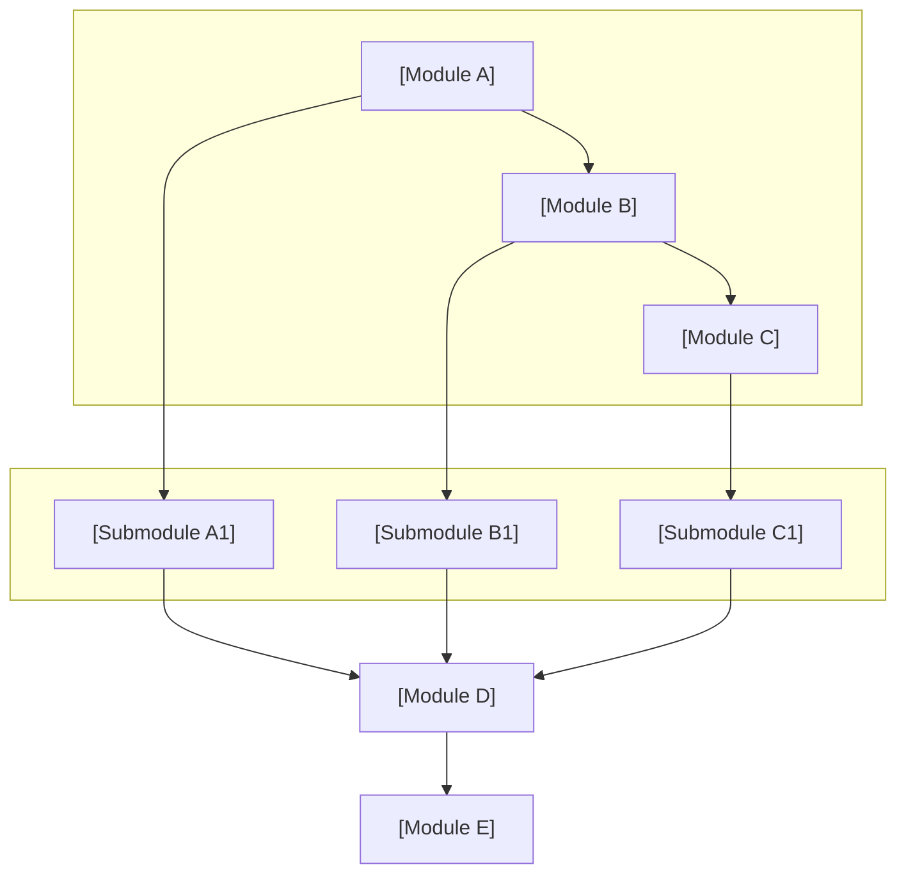

# Patent disclosure template reference (de-identified version)

> English translation of the pinned `nature-skills` reference. Original technical
> examples and executable identifiers are retained. OC Science Lab adaptation:
> write deliverables in English by default; retain Chinese or bilingual output
> when explicitly requested. Translation notices belong to this reference, not
> to the user's disclosure.

## Contents

- [Document header](#document-header)
- [Important notes](#document-header)
- [I. Technical background and prior art](#i-technical-background-and-prior-art)
- [II. Technical problems addressed by the invention](#ii-technical-problems-addressed-by-the-invention)
- [III. Detailed technical solution](#iii-detailed-technical-solution)
- [IV. Advantages over the prior art](#iv-advantages-over-the-prior-art)
- [V. Key technical features and intended protection](#v-key-technical-features-and-intended-protection)
- [VI. Other information](#vi-other-information)
- [De-identification checklist](#de-identification-checklist)
- [Content to exclude from the delivered disclosure](#content-to-exclude-from-the-delivered-disclosure)
- [Formula and parameter consistency checks](#formula-and-parameter-consistency-checks)

This document provides a technical disclosure format and the main points for
each section. Its examples are de-identified and can be used across technical
fields. It is referenced by `disclosure_builder.md`.

---

## Document header

```markdown
# Technical Disclosure

**Case title**: [To be completed] A method and system for XXX

**Technical contact**:
- Name: [To be completed]
- Telephone: [To be completed]
- Email: [To be completed]

**Patent type**: Invention

---

## Important notes

(1) The disclosure must be understandable to the patent representative. In particular, the technical background and detailed technical solution must be comprehensive, clear and complete.
(2) Disclose the technology sufficiently for a person of ordinary skill in the relevant field to implement it without inventive effort.
(3) When communicating with the patent representative, answer and carefully explain technical questions, and provide the requested supplementary technical materials promptly and accurately.
```

When saving into the user's output directory, the main **`.md` / `.docx`
filename** must be **`{normalized_case_title}_{YYYYMMDDHHmmss}`**. See
`disclosure_builder.md` **§7.3** for removing placeholders, handling invalid
characters, shortening long titles and adding timestamps. **Every delivery
requires a timestamp**; avoid fixed filenames unrelated to the title.

---

## I. Technical background and prior art

### 1.1 Prior art

- Follow Step 5 **`prior_art_search.md`** for search channels, link format and prohibited practices; these rules are not repeated here.
- **Search description**, preferably at the start of 1.1: name the **public databases** and **search terms**. Do **not** include script names such as `cnipa_epub_search.py` or process terminology such as “novelty-search fallback.” See **`prior_art_search.md`, “Writing the search description in 1.1.”**
- Group prior work by **technical direction**, such as single-label methods, multi-label methods or clustering strategies.
- For every prior-art entry, give its patent number or literature identifier, applicant or source institution, technical approach, application scenario, **limitations**, and a **public-source URL, which is required**.
  - **CNIPA `abstract`**: when Step 5 JSON includes an **`abstract`**, thoroughly understand it **before** summarizing the technical approach and related details. See **`prior_art_search.md`**. Do not paste the complete official abstract as a large block into the disclosure.
  - **URL requirements** follow `prior_art_search.md`: give **at least one** publicly accessible link for every entry; **verify before insertion** that it works and corresponds to the bibliographic record. **Never invent a link**.
  - **Suggested presentation**: add a separate “**Source link**: …” line under each technical direction, or add a “Link” column to the table.
- Conclude with a search summary and the **essential differences between this invention and the prior art**.

### 1.2 Limitations of the prior art

- List limitations individually, corresponding to the limitations identified in 1.1.
- Emphasize the **central deficiencies**: problems the existing technology cannot solve.

---

## II. Technical problems addressed by the invention

- Explain, point by point, how the invention addresses the deficiencies in Section I.
- Keep this section concise and use it to introduce the detailed solution in Section III.

---

## III. Detailed technical solution

### 3.1 Background

- Describe the application scenario in general terms. De-identify it using labels such as Category A/B/C or Scenario X.
- Summarize the problem addressed by the invention and its central innovations.
- If a human intervention is involved, state its prerequisites, such as samples having salient, distinguishable features.

### 3.2 System block diagram

- Use a **fenced Mermaid** block, preferably `flowchart TB` / `LR` with `subgraph` for layers. Use abstract, general module names and avoid business-specific terminology.
- Before final delivery, use **`scripts/disclosure/mermaid_render.py`** to convert the diagram to PNG and generate Word **by default**. A separate ASCII block diagram is **not required**; the image is authoritative in Word.
- Use a clear hierarchy. Split a complex system into several Mermaid diagrams when useful.

**Mermaid system block diagram template**: replace the title, module names and
connections. Use the same fenced `mermaid` format as in 3.4.



### 3.3 Module functions

**Focus** on each module's **role** and the **relationships between modules**;
the patent description does not primarily emphasize inputs and outputs.

- Role: the module's contribution to the overall solution.
- Relationships: upstream/downstream dependencies, data and control flow, and feedback loops.

### 3.4 System workflow

#### Flowchart

- Use a **fenced Mermaid** code block. Do **not** substitute ASCII text or arrow diagrams.
- Before final delivery, use the repository's **`scripts/disclosure/mermaid_render.py`**, backed by local `mmdc`, to generate PNG and Word **by default**. If Word generation fails, run **`md_to_docx.py`** manually as instructed by the terminal output.

#### Workflow explanation

- Briefly describe the steps or their correspondence to diagram nodes. This explanation **does not replace** the flowchart.
- When the workflow involves algorithms, scoring, constraints or formal variables, collect symbol definitions and principal formulas in **3.4.1**. Follow **`disclosure_builder.md` §7.7**.

### 3.4.1 Symbols and formulas

**Writing order**: first **define symbols and variables**, then give the **core
formulas**, including Equation (1), and finally explain them and relate them
to the workflow.

#### Example symbol tables, ready to use in the Markdown document

```markdown
#### (1) Task-side symbols

| Symbol | Meaning | Index / units |
|--------|---------|---------------|
| \(i\) | Task index | \(i=1,\ldots,N\) |
| \(b_{i,\mathrm{cpu}}\) | CPU-demand weight for task \(i\) | Dimensionless; \(b_{i,\mathrm{cpu}}>0\) |
| \(b_{i,\mathrm{mem}}\) | Memory-demand weight for task \(i\) | As above |

#### (2) Node-side symbols

| Symbol | Meaning | Index / units |
|--------|---------|---------------|
| \(j\) | Compute-node index | \(j=1,\ldots,M\) |
| \(a_{j,\mathrm{cpu}}\) | CPU-resource saturation for node \(j\) | Dimensionless; \(a_{j,\mathrm{cpu}}\le 0\) indicates spare capacity |
```

#### Formula examples and counterexamples: required style

| Situation | Recommended | Avoid |
|-----------|-------------|-------|
| CPU-dimension weight | \(b_{i,\mathrm{cpu}}\) | \(b_i^{cpu}\), whose superscript can be mistaken for an exponent |
| Node saturation | \(a_{j,\mathrm{cpu}} \le 0\) | \(a_j^{cpu} \le 0\) |
| Multiple dimensions | \(b_{i,\mathrm{cpu}},\, b_{i,\mathrm{mem}}\) | \(b_i^{cpu}, b_i^{mem}\) |
| Principal display equation | `\[ M_{ij} = \alpha b_{i,\mathrm{cpu}} + \beta a_{j,\mathrm{cpu}} \tag{1} \]` on one line | Stacking multiple lines with `\\` inside a block, which is prone to rendering failures |
| Logical conjunction | Write “and \(a_{j,\mathrm{mem}}\le 0\)” outside the formula | Text commands such as `\text{and}` inside the formula; the Chinese source example is `\text{且}` (“and”) |

**Inline and display delimiters**: choose either `\(...\)` / `\[...\]` or
`$...$` / `$$...$$` and use the chosen pair throughout the document, consistently
with **`disclosure_builder.md` §7.7**.

### 3.5 Key technical parameters

- For confidence scores and thresholds, state their meanings and valid ranges.
- For algorithm parameters, provide formulas and constraints.
- Include a **“Symbol” column** in parameter tables, using **exactly the same notation as the 3.4.1 symbol tables**. Do not switch to `^{cpu}` in 3.5 when the preceding text uses a subscript.
- Keep parameters consistent with formulas in the text and numerical values in the embodiments.

---

## IV. Advantages over the prior art

- State the overall advantage first, then explain individual points.
- Connect the advantages to the problems addressed in Section II and the intended protection in Section V.
- Put technical implementation details in Section III; focus this section on the arguments for the advantages.

---

## V. Key technical features and intended protection

- List the principal innovations, defining each concisely.
- Refer to Section III for the detailed solution, for example “See 3.4.1 for implementation details.”
- Avoid repeating large sections of technical detail from Section III.

---

## VI. Other information

### Embodiments

- Application scenario, de-identified.
- Known categories and the scale of unlabeled data, de-identified.
- Brief account of the system workflow.
- **Technical effects**, described quantitatively or qualitatively.
- **Example parameter settings**, identified as “not limiting the claims.”

---

## De-identification checklist

| Item | De-identification method |
|------|-------------------------|
| Business or industry names | Abstract into general descriptions |
| Specific classification labels | Category A, Category B, Category C, etc. |
| Specific numbers | Use descriptions such as “a certain scale” or “a preset value” |
| Company or product names | Remove them or use “a system” |

---

## Content to exclude from the delivered disclosure

- Do **not** add repository or skill references, example-repository references, `patent-disclosure-skill`, `examples/` paths, or **meta-footnotes** such as “teaching / fictional example” or “does not constitute a legal or technical commitment” anywhere in the disclosure, particularly **at the end**. Treat the deliverable as a formal technical disclosure draft and **end it with the substantive sections**.
- **OC Science Lab clarification:** this formatting rule does not authorize invented results or concealment of illustrative material. Keep unsupported statements out of a formal disclosure; explicitly distinguish examples from observed evidence in the relevant technical section.

## Formula and parameter consistency checks

- Use consistent formulations throughout, for example for confidence weights and density-adjustment coefficients.
- **Notation:** write resource dimensions as subscripts such as `_{\mathrm{cpu}}`; do **not** use dimension superscripts such as `^{cpu}` or `^{mem}`.
- **Complete symbol tables:** define symbols in 3.4.1; every symbol used in Equation (1) and later equations must appear in a table. Do **not** assign multiple meanings to the same letter.
- **Correct formulas and logic:** eliminate typographical errors; align inequality directions with the prose; ensure formulas, the 3.4 workflow and the 3.3 modules imply consistent behavior; avoid contradictions in boundary cases.
- **Identical notation across sections:** 3.4.1, the 3.5 “Symbol” column, the Section VI embodiments and formulas in the text must match **character for character**.
- Keep threshold ranges consistent, for example 0.5–1.5 or 0.8–1.2.
- Use consistent parameter names rather than alternating between synonymous names.
- Use one LaTeX delimiter convention throughout: `\(...\)` / `\[...\]` or `$` / `$$`.
- Ensure the numerical examples correspond to Section 3.5.
